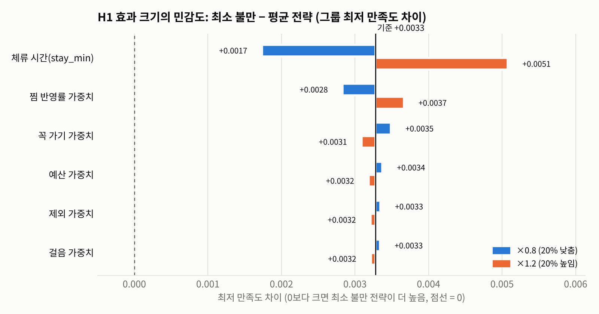
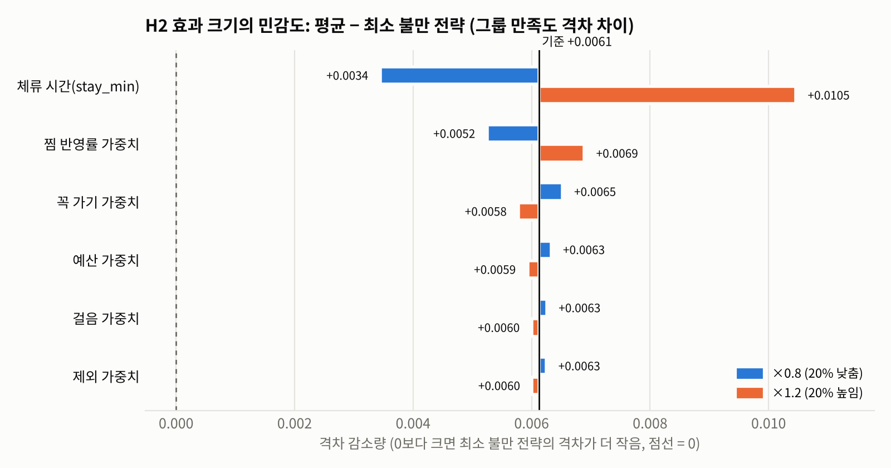
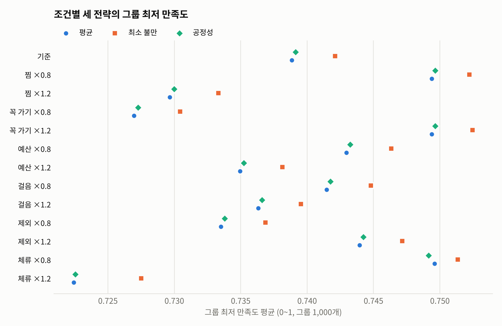

# 민감도 분석 — 11주차

> 이슈 #8 「민감도 분석(윤진)」: 만족도 가중치 5개와 체류 시간(stay_min)을 ±20% 흔들어 결과 변화 측정 · 가상 그룹 1,000개 재시뮬레이션 · 표·그래프
> 사용자 실험 전에 할 수 있는 분석이다. 지금 가중치는 임의로 정한 값이라, **이 값을 조금 바꿔도 전략 비교 결론이 그대로인지**를 먼저 확인한다.

---

## 1. 한눈에 보기

| 질문 | 답 |
| --- | --- |
| 가중치 5개를 ±20% 바꾸면 결론이 바뀌나 | **안 바뀐다.** 만족도 수준만 ±0.01 움직이고, 전략 간 차이와 순위는 그대로다 |
| stay_min을 ±20% 바꾸면 | **가장 민감하다.** 일정의 74~87%가 바뀌고 효과 크기가 절반~1.5배로 움직인다. 방향(최소 불만 > 평균)은 유지된다 |
| 최소 불만 전략이 최저 만족도를 올리나 (H1) | 13개 조건 모두 **예**. 다만 크기가 작다(0~1 척도에서 +0.002~0.005) |
| 최소 불만 전략이 만족도 격차를 줄이나 (H2) | 13개 조건 모두 **예** (격차 −0.003~−0.011) |
| 공정성 전략은 | 13개 조건 모두 **평균 전략과 차이가 없다** (|t| ≤ 1.5). 민감도 문제가 아니라 지금 엔진의 결과다 |

---

## 2. 어떻게 돌렸나

**실제 서비스 엔진**(`backend/engine/real_candidates.mjs`)과 **지금 쓰는 카탈로그 238곳**(`data/runtime_catalog.json`, `osaka_catalog_20261104.json` sha256 `18a28f89f298…`)을 그대로 썼다.

**가상 그룹 1,000개** — 실험설계_10주차.md 2장 조건과 같게 만들었다.
- 4명, 2026-11-16~19(4일). 데이터 검증 기간(11/30) 안의 날짜다.
- 4일 중 하루라도 일정에 들어갈 수 있는 115곳 중 15곳을 그룹이 공유한다. 각자 그중 8곳을 담고, 앞 5곳을 꼭 가기로, 첫 곳을 1순위로 고른다. 다른 사람이 담은 곳 하나는 제외한다.
- 예산 4~10만 원/일, 걸음 7,000~13,000보, 활동 6~9시간.
- 실시간 영업 확인은 모두 통과로 두고 AI 채우기는 껐다. 구성원이 고른 장소만으로 전략을 비교하기 위해서다.
- 시드 `20261111`. 13개 조건 모두 **같은 1,000그룹**을 쓴다.

**흔든 값 (기준 1개 + 12개 조건)**

| 대상 | 기준값 | 바꾼 값 |
| --- | --- | --- |
| 찜 반영률 가중치 `pick` | 0.35 | ×0.8, ×1.2 |
| 꼭 가기 가중치 `must` | 0.30 | ×0.8, ×1.2 |
| 예산 가중치 `budget` | 0.15 | ×0.8, ×1.2 |
| 걸음 가중치 `walk` | 0.10 | ×0.8, ×1.2 |
| 제외 가중치 `veto` | 0.10 | ×0.8, ×1.2 |
| 체류 시간 `stay_min` | 장소별 값 | 모든 장소 ×0.8, ×1.2 |

- 가중치는 하나만 바꾼 뒤 **합이 1이 되게 다시 나눴다.** 그래야 만족도가 0~1 범위에 머문다.
- 만족도는 `consensus.ts`의 `satisfactionOf`를 그대로 불러서 계산했다.

**본 지표**
- **그룹 최저 만족도**: 그룹 4명 중 가장 낮은 사람의 만족도 (H1)
- **그룹 만족도 격차**: 가장 높은 사람 − 가장 낮은 사람 (H2)
- 전략 차이는 같은 그룹끼리 짝지어 뺀 값의 평균과 t값이다 (대응 비교).

---

## 3. 결과

### 3.1 조건별 표

H1 = 최소 불만 − 평균 전략의 최저 만족도 차이 (클수록 최소 불만이 낫다).
H2 = 평균 − 최소 불만 전략의 격차 차이 (클수록 최소 불만의 격차가 작다).

| 조건 | 최저 만족도 (평균 / 최소 불만 / 공정성) | H1 차이 (t) | H2 차이 (t) | 일정이 바뀐 그룹 |
| --- | --- | --- | --- | --- |
| **기준** | 0.739 / 0.742 / 0.739 | **+0.0033** (5.7) | **+0.0061** (6.9) | — |
| 찜 ×0.8 | 0.749 / 0.752 / 0.750 | +0.0028 (5.7) | +0.0052 (6.9) | 0% |
| 찜 ×1.2 | 0.730 / 0.733 / 0.730 | +0.0037 (5.7) | +0.0069 (6.9) | 0% |
| 꼭 가기 ×0.8 | 0.727 / 0.730 / 0.727 | +0.0035 (5.7) | +0.0065 (6.9) | 0% |
| 꼭 가기 ×1.2 | 0.749 / 0.752 / 0.750 | +0.0031 (5.7) | +0.0058 (6.9) | 0% |
| 예산 ×0.8 | 0.743 / 0.746 / 0.743 | +0.0034 (5.7) | +0.0063 (6.8) | 0% |
| 예산 ×1.2 | 0.735 / 0.738 / 0.735 | +0.0032 (5.7) | +0.0059 (6.9) | 0% |
| 걸음 ×0.8 | 0.741 / 0.745 / 0.742 | +0.0033 (5.7) | +0.0063 (6.9) | 0% |
| 걸음 ×1.2 | 0.736 / 0.740 / 0.737 | +0.0032 (5.7) | +0.0060 (6.9) | 0% |
| 제외 ×0.8 | 0.734 / 0.737 / 0.734 | +0.0033 (5.7) | +0.0063 (6.9) | 0% |
| 제외 ×1.2 | 0.744 / 0.747 / 0.744 | +0.0032 (5.7) | +0.0060 (6.9) | 0% |
| 체류 ×0.8 | 0.750 / 0.751 / 0.749 | +0.0017 (4.0) | +0.0034 (5.4) | **73.6%** |
| 체류 ×1.2 | 0.722 / 0.728 / 0.723 | +0.0051 (7.4) | +0.0105 (9.9) | **86.6%** |

전체 숫자(평균 만족도, 하루 배치 수, 공정성 전략 비교, 순위)는 `docs/sensitivity/table.csv`와 `results.json`에 있다.

### 3.2 그래프

**H1 효과 크기가 무엇에 가장 흔들리나** (위쪽일수록 영향이 크다)



**H2 효과 크기가 무엇에 가장 흔들리나**



**조건별 세 전략의 최저 만족도** — 수준은 위아래로 움직여도 최소 불만(■)이 늘 오른쪽에 있다



---

## 4. 해석

**① 가중치는 결론을 바꾸지 않는다**
- 가중치는 만족도를 **채점**하는 데만 쓰이고, 일정을 **고르는** 데(`utilityOf`)에는 쓰이지 않는다. 그래서 가중치를 바꿔도 일정은 1,000그룹 모두 그대로였다(엔진을 다시 돌려 확인).
- 만족도 수준은 0.727~0.750 사이에서 움직이지만, 전략 간 차이는 H1 +0.0028~0.0037, H2 +0.0052~0.0069로 거의 그대로다. t값도 5.7·6.9로 같고, 전략 순위도 같다.
- 따라서 13주에 실험으로 가중치를 다시 정해도(#7) **±20% 범위 안이면 H1·H2 결론은 유지될 가능성이 높다.**

**② stay_min이 가장 민감하다**
- 체류 시간은 하루에 몇 곳이 들어가는지를 바꾼다. 하루 배치 수가 기준 9.6곳에서 ×0.8이면 10.0곳, ×1.2이면 9.0곳이 된다. 그래서 일정 자체가 74~87% 바뀐다.
- 시간이 넉넉하면(×0.8) 누구의 장소든 대부분 들어가서 전략 차이가 줄어든다(H1 +0.0017). 이때는 최소 불만이 더 나은 그룹(22.9%)과 더 나쁜 그룹(22.4%)이 거의 같다.
- 시간이 빠듯하면(×1.2) 누구를 먼저 챙기느냐가 중요해져서 차이가 커진다(H1 +0.0051).
- 방향은 두 경우 모두 유지되지만, **효과 크기는 체류 시간 추정에 크게 좌우된다.** 그래서 체류 시간은 계속 추정값을 쓰기보다 공식 자료나 실제 이용 기록으로 확인할 우선순위가 가장 높다.

**③ 효과 자체가 작다**
- 기준에서 H1 차이는 0~1 척도의 +0.0033이다. 1,000그룹이라 t값은 크지만, 실제로 체감할 만한 크기는 아니다.
- 세 일정이 서로 다르게 나온 그룹이 65%이고, 나머지 35%는 세 일정이 같아서 차이가 0이다. 다르게 나온 그룹만 보면 차이가 더 크다.

**④ 공정성 전략은 평균 전략과 같다**
- 13개 조건 모두 공정성과 평균의 차이가 없다(H1 |t| ≤ 1.5, H2 |t| ≤ 1.0). 가중치나 체류 시간 문제가 아니다.
- 기준 조건에서 공정성 전략의 일정이 평균 전략과 **완전히 같은 그룹이 81.9%**다(최소 불만은 39.2%). 실제 장소 경로에서는 1순위 꼭 가기를 먼저 넣고, 하루 자리 수와 운영·예산 검사가 같아서, 그날 후보 순서만 바꾸는 공정성 점수가 결과를 거의 바꾸지 못하는 것으로 보인다.
- 공정성 전략에 대한 H1·H2는 **현재 엔진에서는 지지되지 않는다**고 그대로 보고하고, 원인은 따로 확인한다.

---

## 5. 한계

- 가상 그룹이다. 사람들이 실제로 고르는 방식(인기 장소 쏠림, 취향 겹침)과 다를 수 있다.
- AI 채우기를 끄고 실시간 영업 확인을 모두 통과로 두었다. 실제 서비스에서는 일정이 더 채워질 수 있다.
- 만족도는 지금 계산식으로 낸 값이다. 실제로 사람이 느끼는 만족도와의 관계는 사용자 실험(Q3)으로 확인한다.
- 체류 시간은 모든 장소를 같은 비율로 바꿨다. 실제 오차는 장소마다 다르다.

---

## 6. 다시 돌리는 법

```sh
# 저장소 루트에서 (Node 24, 또는 Node 22 + --experimental-strip-types)
node scripts/experiment/sensitivity.mjs                 # 1,000그룹, 약 1분 → docs/sensitivity/results.json · table.csv
python3 scripts/experiment/sensitivity_plot.py          # 그래프 3개 → docs/sensitivity/*.png
node scripts/experiment/sensitivity.mjs --groups 100    # 빠른 확인 (파일 안 씀)
```

**13주 (실험 후)**: 사용자 실험으로 가중치를 다시 정하면 그 값을 기준으로 같은 분석을 돌린다(#7 → #8).

```sh
node scripts/experiment/sensitivity.mjs --weights '{"pick":0.40,"must":0.25,"budget":0.15,"walk":0.10,"veto":0.10}'
```

엔진이나 카탈로그가 바뀌면 다시 돌려서 이 문서의 숫자를 고친다.
